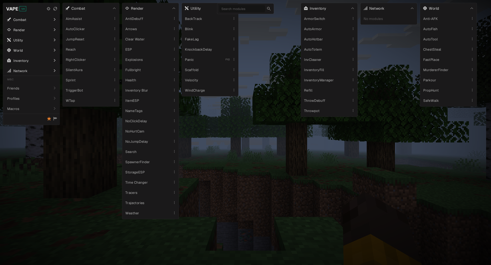
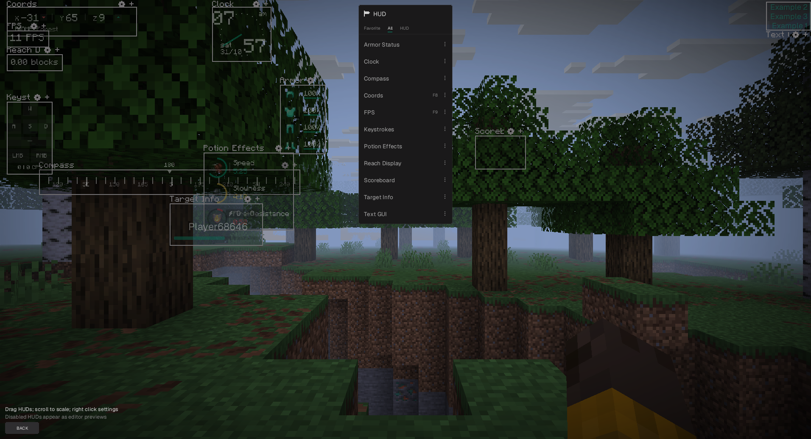

# vape-rs

A from-scratch recreation of the **Vape** Minecraft client as a native Rust mod for the [Horizon](https://github.com/horizon-rust/horizon) client (Minecraft 26.3). It is not Java, not injected and has no accounts or online services: it runs locally as a Horizon native mod, and all settings, profiles, friends and macros stay on your machine.

> **Status: work in progress.** Many modules exist, but only some have been validated in a real game, and visual/behavioral parity with the original is not claimed. See [docs/status.md](docs/status.md) and [docs/progress.md](docs/progress.md).



*The click GUI (Right Shift) with all six category frames open. HUD widgets are listed in the HUD editor (flag icon):*



## What works today

Tested in a real game (fresh test instances, single player and LAN):

- **Combat:** AutoClicker, RightClicker, TriggerBot, JumpReset, WTap, Sprint, KeepSprint, Velocity, HitBoxes, BlockHit, HitSelect, HitSwap, ShieldBreaker, TargetFilter.
- **Movement:** Speed, Fly, NoFall, NoSlowdown, InvWalk, Timer, SafeWalk, Scaffold (Legit), NoItemRelease, WindCharge, Freecam.
- **World / utility:** Anti-AFK, AutoFish, FastPlace, Backtrack, KnockbackDelay, AutoPearl, PearlCatch, AutoTool, Panic (F10).
- **Inventory:** Refill, Throwpot, ThrowDebuff, AutoHeal, AutoTotem, ChestSteal, InventoryManager, InvCleaner, AutoHotbar, ArmorSwitch.
- **Render:** Fullbright, Clear Water, NoHurtCam, ItemESP, Time Changer, Weather, AntiDebuff, Inventory Blur, NoClickDelay, NoJumpDelay, ESP, Tracers, NameTags, Search, SpawnerFinder, StorageESP, Trajectories, Projectiles, Arrows, Health, Explosions, Indicators, BedPlates, Block Overlay, PropHunt, MurdererFinder.
- **HUD:** Armor Status, Potion Status, Coords, FPS, Compass, Clock, Keystrokes, Reach Display, Target Info, toggle notifications, with an in-game layout editor.

Running in the game but not yet covered by a full test scenario: AimAssist, KillAura, SilentAura, AutoArmor, AutoMace, InventoryFill, Parkour, Blink, FakeLag, Freelook, Scaffold's GodBridge/TellyBridge, Text GUI, Scoreboard, plus the click GUI's search/favorites, profiles, friends/enemies, binds and macros. AntiFireball and HitFlick are partly connected. Reach, Chams, XRay, ESP Skeleton and Throwpot's soup modes need host support that the pinned Horizon does not offer yet. CrystalAura, AutoAnchor, BedBreaker, Block-In, Clutch, MLG, AutoLadder and MotionBlur are still to be ported.

Modules start disabled. F10 turns every active module off. AI behavior and the online product are intentionally not part of this project.

## Install

Requires Horizon's launcher (0.2.27+) with a Nightly installed for Minecraft 26.3.

```sh
python3 tools/bundle.py                      # builds dist/vape_rs-<version>.hnmod
mkdir -p ~/vape_rs && cd ~/vape_rs && unzip /path/to/vape_rs-0.1.0-dev.hnmod
horizon-launcher native-build ~/vape_rs --trust-native-code
```

The first build downloads Rust and takes 20–30 minutes. Native mods run with your full OS privileges, so read the source first. Only Linux x86-64 has been exercised.

## Building and contributing

See [docs/development.md](docs/development.md). You need Rust 1.99.0 (pinned in `rust-toolchain.toml`, required by Horizon). Never run tests against real player data.

## Disclaimer

This is an independent, unofficial project. It is **not affiliated with or endorsed by** the makers of Vape, Mojang or Microsoft, and contains no code or assets from them. "Minecraft" is a trademark of Mojang AB. Using client modifications on multiplayer servers can get you banned; use it where it is allowed, and at your own risk.

## License

[MIT](LICENSE).
